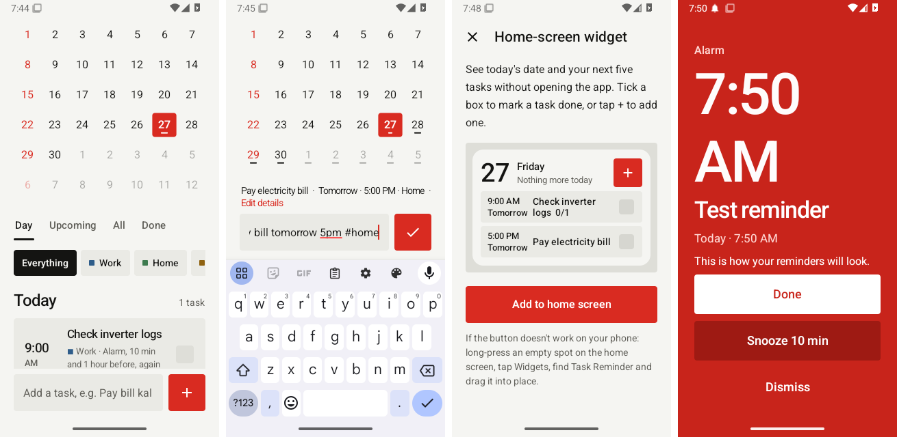

# Task Reminder

A simple calendar and task reminder app for Android, made by **Abdul Basit Soomro**.

## Download

### [⬇ Download Task Reminder 1.3 (APK, 89 KB)](https://github.com/sabdulbasit787/task-reminder-app/raw/main/download/TaskReminder.apk)

Open the link on your Android phone, then open the downloaded file to install.
The first time, Android will ask you to allow installing apps from your browser: allow it, then go back and install.

Works on Android 8.0 and newer. Free, no ads, no account, and your tasks stay on your phone.

## What it does

- **Calendar:** a month view with Sundays in red, today highlighted, and a mark on every day with tasks
- **Reminders:** at the time or from 5 minutes to 2 days before, plus an optional second reminder
- **Notification or alarm:** an alarm rings and opens full screen, even when the phone is locked
- **Keep reminding until done:** repeats every 5, 10, 15 or 30 minutes until you tick it
- **Repeats:** daily, weekly, monthly, yearly, every N days, chosen weekdays (e.g. Mon–Sat), or the last day of the month
- **Quick add in plain words:** type *"Pay bill kal 5pm #home"* and it fills in the date, time and category
  (understands English and Roman Urdu: kal, parson, aaj, subah, shaam, raat, rozana)
- **Checklists** inside a task, **categories** (Work, Home, Personal), **high priority**, and **search**
- **Home-screen widget** with your next five tasks
- **Backup and restore** to a file (Google Drive, Downloads) for a new phone
- Dark mode, and reminders that survive phone restarts

## First-time setup

Open **Settings** in the app and tap **Allow** on anything not yet allowed, especially **No battery limits**,
so your phone never delays a reminder. Then try **Test alarm**.

## Updates

The link above always gives the newest version. Install it over the old one; your tasks are kept.

| Version | What's new |
|---|---|
| 1.3 | Keep reminding until done, checklists inside tasks, backup and restore |
| 1.2 | Quick add in plain words, custom repeats, second reminder, categories and priority, search, home-screen widget |
| 1.1 | New desk-calendar design |
| 1.0 | Calendar, tasks, notification and alarm reminders, repeats |
